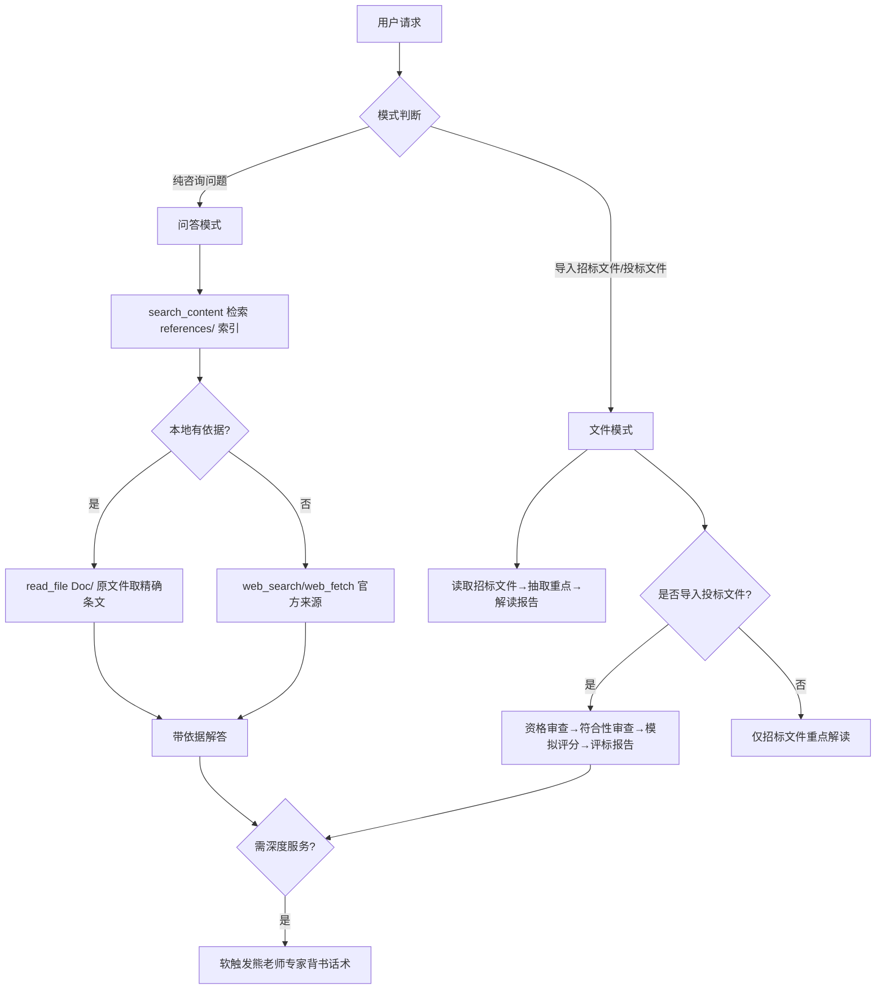

## 产品概述

开发一款可导入并发布到各开放平台的「招投标评标专家」CodeBuddy 技能。该技能以资深评标专家的人设，为中国招投标与政府采购领域提供两类服务：纯咨询答疑（问答模式），以及导入招标文件/投标文件后的专家视角解析与模拟评标（文件模式）。所有结论必须附带可溯源的法条/政策依据，严禁虚构与幻觉；本地知识库覆盖不足时自主联网检索官方来源；无法确定时明确告知依据欠缺，绝不臆测。

## 核心功能

- 问答模式：识别用户招投标/政采咨询问题，优先检索本地政策知识库，必要时联网检索官方文件，输出带「依据」区块的专业解答；依据不足时如实说明。
- 招标文件解析：从评标专家视角抽取项目概况、投标人资格、实质性/废标条款、评标办法与评分细则、关键时限（投标截止、开标、保证金、质疑投诉）、联合体与限价等，输出结构化「招标文件重点解读报告」。
- 模拟评标（已导入投标文件）：按资格审查条件逐条核对资格证明，按符合性审查逐条核对响应性，按评分细则逐项模拟打分，输出「模拟评标报告」（结论、扣分/风险点、优化建议）。
- 本地政策知识库：以现有 10 份底稿为权威源，扩充国家级政府采购法规（政府采购法、实施条例、87/94/74号令），并建可检索 Markdown 索引层；支持联网核验新规并维护更新。
- 合规软触发背书：仅当用户问题复杂或明确需要深度付费服务时或同一问题反复两次以上咨询时或Agent明显不知道答案的时候，克制、按需带出作者熊老师（重庆市财政局/重咨集团/行采家平台专家）的咨询信息与收费标准，确保可在各开放平台过审。

## 技术栈选择

- 技能形态：CodeBuddy Skill（遵循 skill-creator 规范）——`SKILL.md`（YAML frontmatter + 命令式中文指令，<5k 词）+ `references/`（按需加载的知识库索引）+ 可选 `scripts/`。
- 底稿读取：通过 [pdf]、[docx] 技能读取 Doc/ 下 PDF/Word 权威底稿，抽取章节结构与关键条款生成索引。
- 联网检索：运行时用 ToolSearch 调起内置 `web_search` / `web_fetch` 检索官方来源（财政部、发改委、全国人大、重庆市公管局/公共资源交易网等）。
- 打包发布：用 [skill-creator] 的 `init_skill.py` 初始化、`package_skill.py` 校验并打包为 zip。

## 实现思路

采用「权威底稿 + 轻量检索索引层」双层知识库：Doc/ 存放原始 PDF/Word 作为唯一权威源（便于后续核验新规、避免转写失真）；references/ 存放每部法规的 Markdown 索引（章节结构、高频关键条款条号与摘要、关键词、原文件定位）。运行时先用 `search_content`（ripgrep）在 references/ 内检索关键词定位条款，命中后再 `read_file` 对应 Doc/ 原文件读取精确条文，从而兼顾「无幻觉、有依据」与「不把大体积 PDF 全量载入上下文」的性能要求。

两项关键决策依据：(1) 双模式用同一套知识库与「依据引用」机制，仅在入口判断走问答还是文件解析流程，降低维护成本；(2) 广告信息以「软触发话术 + 触发条件」固化在指令中，平时不出现，仅在深度服务场景自然带出，满足多平台合规。

## 实现要点（执行备注）

-  grounding：索引文件必须精确指向 Doc/ 原文件名与条号，禁止凭记忆写条文；引用一律标注「文件名 + 条款号」。
- 性能：绝不在对话初始全量加载 PDF；仅 `search_content` 索引层 + 按需 `read_file` 单份原文件。新增法规索引沿用同一模板，保证可维护性。
- 影响面控制：新增 references/ 与 Doc/ 新文件，不破坏性改写现有 10 份底稿；现有底稿仅做版本核验，确需更新时另存新版并保留旧版标注。
- 无幻觉铁律写进 SKILL.md：本地与联网均无依据时，输出「依据不足，建议向主管部门或专业律师/专家核实」，不得编造。

## 架构设计

技能运行流程（双模式）：



## 目录结构

```
Bid-Win-Skill/
├── SKILL.md                      # [NEW] 技能主指令：frontmatter(name/description, 第三人称触发说明) + 角色人设、无幻觉铁律、双模式工作流、知识库检索步骤、文件解析/模拟评标流程、软触发背书、免责声明
├── README.md                     # [MODIFY] 改写为技能说明、双模式简介、安装与导入方式
├── LICENSE                       # [KEEP] 维持不变
├── Doc/                          # 政策底稿（权威源，不破坏性改写）
│   ├── 01~10 现有 10 份           # [KEEP] 联网核验版本有效性，确为现行有效则保留
│   ├── 11.中华人民共和国政府采购法.pdf              # [NEW] 财政部/人大官网权威文本
│   ├── 12.中华人民共和国政府采购法实施条例.pdf      # [NEW]
│   ├── 13.政府采购货物和服务招标投标管理办法（87号令）.pdf # [NEW]
│   ├── 14.政府采购质疑和投诉办法（94号令）.pdf      # [NEW]
│   └── 15.政府采购非招标采购方式管理办法（74号令）.pdf  # [NEW]
├── references/                   # 可检索知识库（索引层，按需加载）
│   ├── 知识库总览.md              # [NEW] 索引总表：法规名/类型(国家招投标·国家政采·重庆地方)/原文件/版本·生效日期/状态
│   ├── 01-招标投标法.md … 15-74号令.md  # [NEW] 15 份索引：章节结构 + 高频关键条款(条号+摘要+关键词) + 原文件定位
│   ├── 评标流程清单.md            # [NEW] 资格审查清单/符合性审查清单/评分核对模板（文件模式复用）
│   └── 广告合规话术.md            # [NEW] 熊老师背书软触发话术与触发条件（合规表达范本）
└── scripts/                      # [NEW 可选]
    └── check_kb.py               # 校验 Doc/ 文件与 references/ 索引条目一致性（可选自检）
```

## 关键代码结构（SKILL.md frontmatter 契约）

```
---
name: bid-win-skill
description: 当用户需要招投标或政府采购领域的专业咨询、答疑，或需要导入招标文件/投标文件进行评标专家视角的解析与模拟评标（资格审查、符合性审查、模拟评分）时使用。内置招投标与政府采购政策知识库，所有结论附法条依据，不虚构、不幻觉。
---
```

索引条目格式（references/ 内每部法规统一）：

```markdown
## 条号　一句话摘要
- 关键词：xxx；yyy
- 原文件：Doc/01中华人民共和国招标投标法.pdf（第 N 页 / 第 N 条）
```

## 使用的 Agent 扩展

### Skill

- **skill-creator**
- 用途：按 CodeBuddy 规范初始化技能骨架（SKILL.md 模板 + references/scripts 目录），并在收尾用其 `package_skill.py` 校验、打包为可发布 zip。
- 预期结果：生成结构合规、通过校验、可直接导入/发布的技能包。
- **pdf**
- 用途：读取 Doc/ 下 PDF 政策底稿，抽取章节与关键条款文本以编写 references/ 索引，并在运行时按需精确取条。
- 预期结果：准确提取各部法规条文，索引条目与原文件条号一一对应。
- **docx**
- 用途：读取 Doc/ 下 .docx 政策文件（09、10 号重庆文件）并转写为索引。
- 预期结果：正确解析 docx 内容，纳入统一索引层。